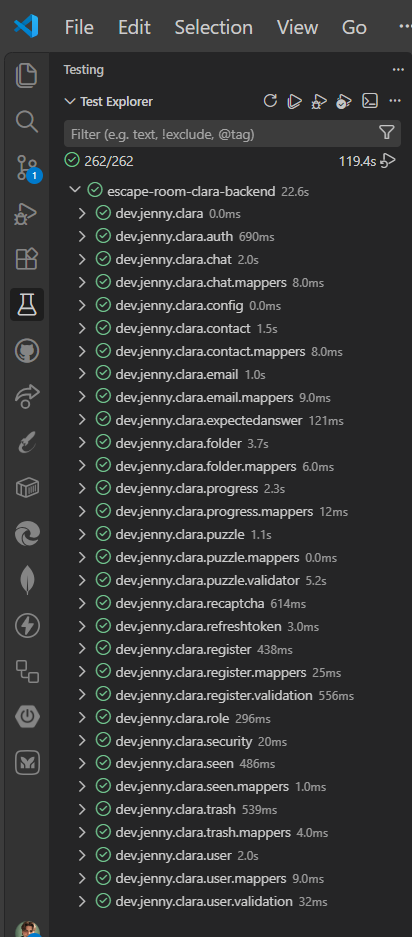
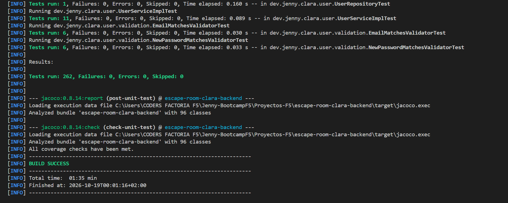
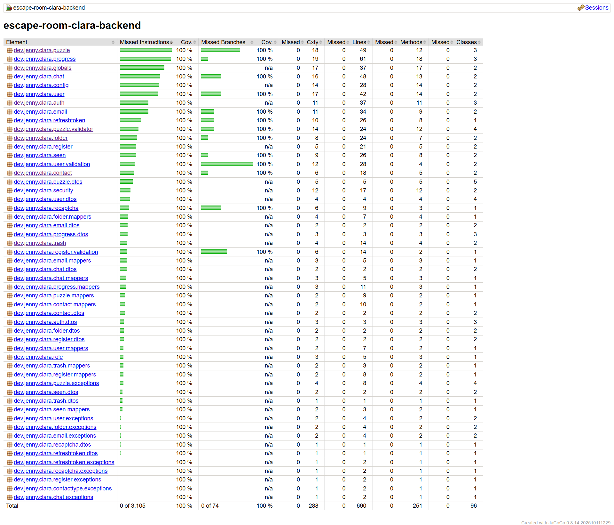
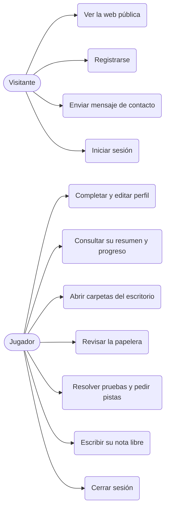
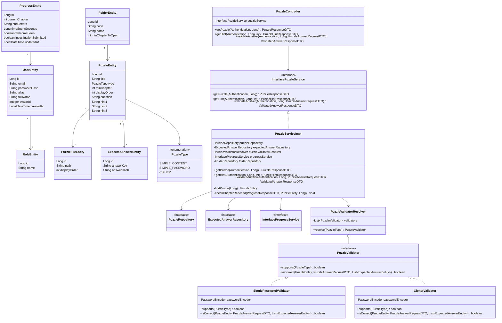
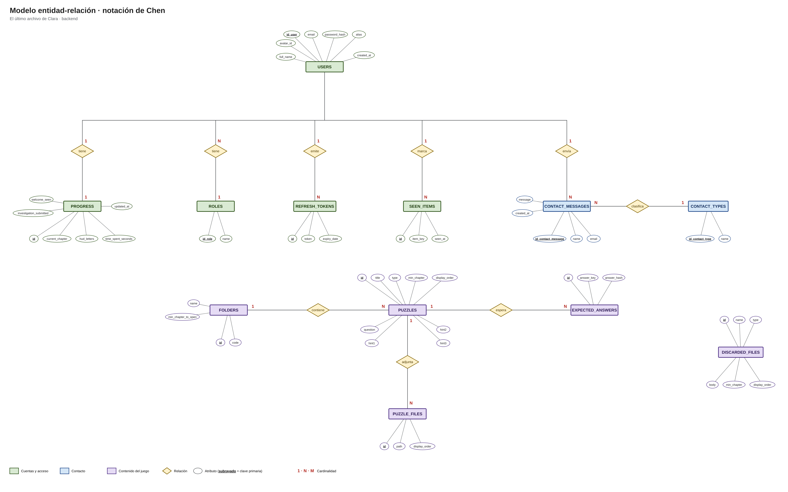
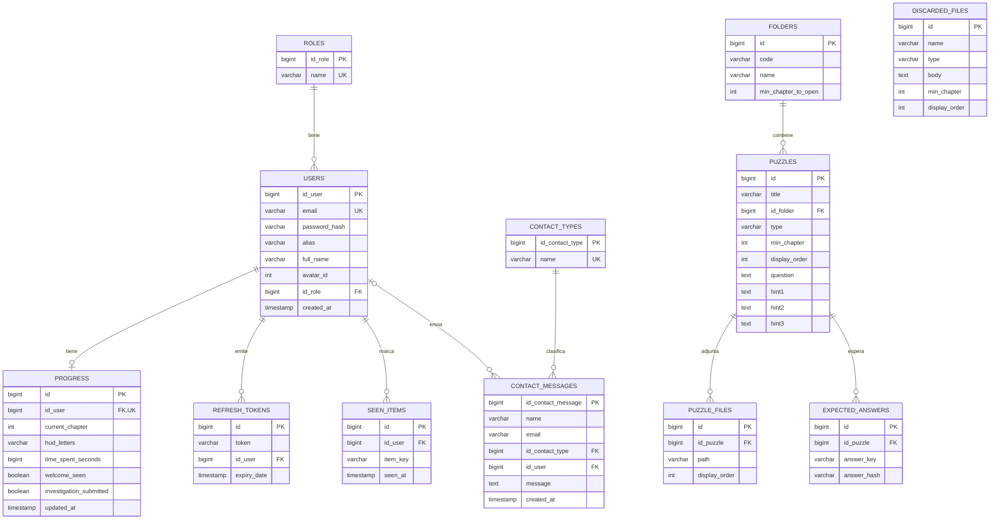
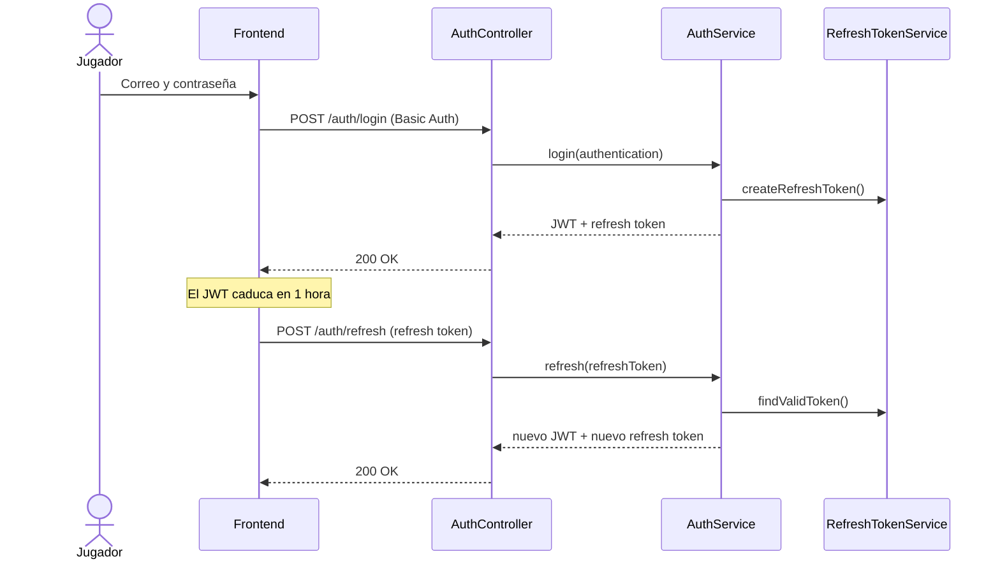
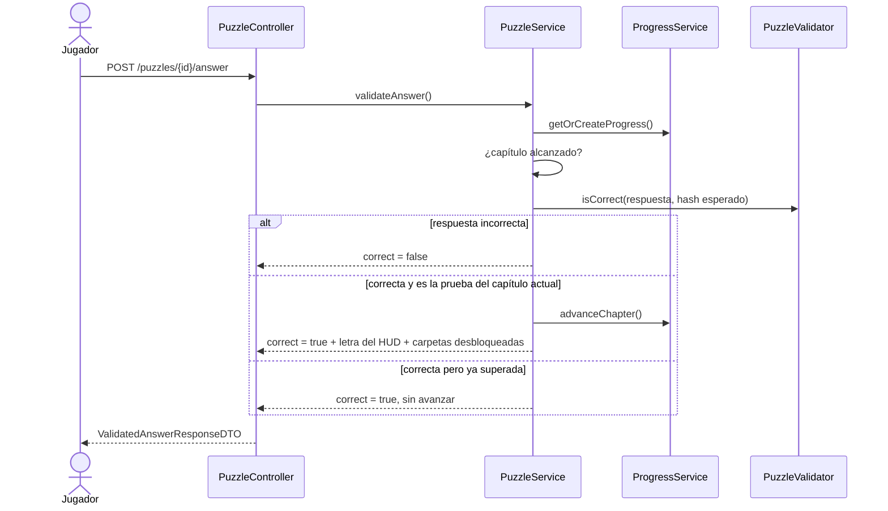

# 🗝️ El Último Archivo de Clara · Backend

> Si estás buscando a Clara, estás empezando por el final.

**API REST** construida con **Spring Boot** para _El último archivo de Clara_, un escape room narrativo de investigación. Desarrollada en **Java 25** con **Spring Data JPA**, **Spring Security** con **JWT** y **PostgreSQL** en Docker, verificada siguiendo **TDD** con **JUnit 5, Mockito y Hamcrest**, con cobertura de tests medida con **JaCoCo**.

---

## 📸 Vista rápida

| 🧭 Test Explorer | 🧪 Tests | 📊 Coverage |
| :---: | :---: | :---: |
|  |  |  |

---

## 📑 Índice

- [Descripción](#-descripción)
- [Cómo reproducir](#-cómo-reproducir)
- [Endpoints](#-endpoints)
- [Diagramas](#-diagramas)
- [Estructura](#-estructura)
- [Testing](#-testing)
- [Cobertura](#-cobertura)
- [Diseño y gestión del proyecto](#-diseño-y-gestión-del-proyecto)
- [Siguientes pasos](#-siguientes-pasos)
- [Tecnologías](#-tecnologías)
- [Autora](#-autora)
- [Aviso](#-aviso)

---

## 📋 Descripción

API REST que da soporte al escape room narrativo _El último archivo de Clara_. El jugador investiga el portátil de Clara (**ClaraOS**): abre carpetas, revisa la papelera, resuelve pruebas y, cada vez que acierta, avanza de capítulo y desbloquea más contenido.

El backend se encarga de:

- **Autenticación y cuentas**: registro con reCAPTCHA, login, renovación y cierre de sesión con **JWT** (token de acceso + refresh token), perfil del usuario y cambio de contraseña.
- **Progreso del jugador**: capítulo actual, letras del HUD, tiempo invertido, nota libre y mensaje de bienvenida visto.
- **Contenido narrativo por capítulos**: carpetas, pruebas, pistas y papelera de archivos descartados. Cada elemento tiene un capítulo mínimo (`minChapter`): hasta que el jugador no lo alcanza, el servidor no lo entrega.
- **Validación de respuestas en el servidor**: las respuestas esperadas se guardan como **hash**, nunca en claro, y cada tipo de prueba (`SIMPLE_CONTENT`, `SIMPLE_PASSWORD`, `CIPHER`) tiene su propio validador.
- **Contacto**: formulario público protegido con reCAPTCHA.

Sigue una arquitectura **por capas y por funcionalidad** (Controller → Service → Mapper → Repository → Entity), con DTOs, manejo centralizado de excepciones (`GlobalExceptionHandler`), principios **SOLID** y los patrones **Strategy** (validadores de pruebas) y **Builder** donde corresponde.

Es la contraparte de [`escape-room-clara-frontend`](https://github.com/Jennydev-25/escape-room-clara-frontend), que consume esta API.

[Volver al índice](#-índice)

---

## 🚀 Cómo reproducir

### Requisitos

- **JDK 25** ([descarga](https://www.oracle.com/java/technologies/downloads/))
- **Docker** con **Docker Compose** ([instalación](https://docs.docker.com/get-docker/)) para la base de datos PostgreSQL
- **Maven** no hace falta instalarlo: el proyecto incluye el wrapper (`mvnw`)

### Pasos

1. **Clona el repositorio**

   ```bash
   git clone https://github.com/Jennydev-25/escape-room-clara-backend.git
   cd escape-room-clara-backend
   ```

2. **Crea tu configuración de arranque en VS Code.** Copia `launch.example.json` a `.vscode/launch.json` (esa carpeta no se sube al repositorio) y rellena las variables de entorno:

   | Variable | Para qué sirve |
   | --- | --- |
   | `POSTGRES_DB`, `POSTGRES_USER`, `POSTGRES_PASSWORD` | Credenciales de PostgreSQL. Las usa `compose.yaml` para crear la base de datos. |
   | `JWT_SECRET_KEY` | Clave con la que se firman los JWT (HS512). Usa una cadena larga y aleatoria. |
   | `RECAPTCHA_SECRET_KEY` | Clave secreta de [Google reCAPTCHA](https://developers.google.com/recaptcha/docs/verify) para verificar registro y contacto. |

3. **Arranca la aplicación** desde VS Code con esa configuración (el botón ▶ de Spring Boot Dashboard o _Run and Debug_ → `escape-room-clara-backend`).

   Gracias a **Spring Boot Docker Compose Support**, al arrancar levanta solo el contenedor de PostgreSQL y detecta host, puerto y credenciales. La API queda en `http://localhost:8080/api/v1`.

4. **Carga inicial de datos**: `data.sql` se ejecuta al arrancar y crea los roles, las carpetas, las pruebas con sus respuestas (en hash) y la papelera.

> **Nota:** los datos se conservan entre arranques: la base de datos usa un volumen de Docker (`postgres_data`), Hibernate trabaja con `ddl-auto=update` y `data.sql` solo rellena las tablas que están vacías.

### Configuración

La configuración está en `src/main/resources/application.properties`:

| Propiedad | Valor | Descripción |
| --- | --- | --- |
| `api-endpoint` | `api/v1` | Prefijo de todos los endpoints |
| `cors.allowed-origin` | `http://localhost:5173` | Origen del frontend permitido por CORS |
| `jwt.access-token.expiration-hours` | `1` | Duración del token de acceso |
| `jwt.refresh-token.expiration-days` | `30` | Duración del refresh token |
| `spring.profiles.active` | `postgres` | Perfil por defecto. El perfil `h2` usa una base en memoria para desarrollo y tests |

[Volver al índice](#-índice)

---

## 🔌 Endpoints

Todos los endpoints cuelgan de `/api/v1`. Salvo los marcados como públicos, **requieren autenticación**: `Authorization: Bearer <token>` (el login usa **Basic Auth** y devuelve el JWT).

| Método | Ruta | Descripción | Acceso |
| --- | :--- | :--- | :---: |
| `POST` | `/auth/register` | Crea una cuenta (con reCAPTCHA) | Público |
| `POST` | `/auth/login` | Inicia sesión con Basic Auth y devuelve token + refresh token | Basic |
| `POST` | `/auth/refresh` | Renueva el token con el refresh token | Público |
| `POST` | `/auth/logout` | Cierra sesión y revoca el refresh token | JWT |
| `GET` | `/users/me` | Perfil del usuario autenticado | JWT |
| `PUT` | `/users/me` | Actualiza nombre, alias y correo | JWT |
| `PUT` | `/users/me/complete-profile` | Completa el perfil tras el registro | JWT |
| `PUT` | `/users/me/password` | Cambia la contraseña | JWT |
| `GET` | `/progress` | Progreso del jugador (lo crea si no existe) | JWT |
| `PATCH` | `/progress/time` | Acumula el tiempo invertido | JWT |
| `PATCH` | `/progress/note` | Guarda la nota libre del jugador | JWT |
| `PATCH` | `/progress/welcome` | Marca el mensaje de bienvenida como visto | JWT |
| `GET` | `/folders` | Carpetas del escritorio y si están desbloqueadas | JWT |
| `GET` | `/folders/{code}` | Contenido de una carpeta | JWT |
| `GET` | `/puzzles/{id}` | Enunciado de una prueba | JWT |
| `GET` | `/puzzles/{id}/hints/{number}` | Pista 1, 2 o 3 de una prueba | JWT |
| `POST` | `/puzzles/{id}/answer` | Valida la respuesta y, si procede, avanza de capítulo | JWT |
| `GET` | `/trash` | Archivos de la papelera | JWT |
| `GET` / `POST` | `/seen` | Consulta y registra los elementos ya vistos | JWT |
| `POST` | `/contact` | Envía el formulario de contacto (con reCAPTCHA) | Público |

Los errores se devuelven con un formato único (`ApiErrorDTO`) gracias a `GlobalExceptionHandler`.

[Volver al índice](#-índice)

---

## 🗺️ Diagramas

<details>
<summary><b>1. Casos de uso</b></summary>



</details>

<details>
<summary><b>2. Clases</b></summary>

Entidades principales y el flujo de las pruebas: el controlador llama al servicio y este delega en el **Strategy** de validadores, donde cada tipo de prueba tiene el suyo y `PuzzleValidatorResolver` elige el que corresponde.



</details>

<details>
<summary><b>3. Entidad-relación (notación de Chen)</b></summary>



Hecho en **draw.io**.

</details>

<details>
<summary><b>4. Entidad-relación (patas de gallo)</b></summary>

Esquema físico de la base de datos, con las claves primarias (PK), las claves foráneas (FK) y las restricciones únicas (UK).



</details>

<details>
<summary><b>5. Secuencia</b></summary>

**Login y renovación del token**



**Responder una prueba**



</details>

[Volver al índice](#-índice)

---

## 📁 Estructura

```text
escape-room-clara-backend/
├── compose.yaml                      # PostgreSQL 16 en Docker
├── pom.xml
├── mvnw / mvnw.cmd                   # Maven Wrapper
└── src/
    ├── main/
    │   ├── java/dev/jenny/clara/
    │   │   ├── App.java
    │   │   ├── auth/                 # login, refresh, logout, JWT
    │   │   ├── register/             # registro y validación de contraseñas
    │   │   ├── user/                 # perfil y contraseña
    │   │   ├── progress/             # progreso, HUD, tiempo y nota
    │   │   ├── folder/               # carpetas del escritorio
    │   │   ├── puzzle/               # pruebas, pistas y validadores
    │   │   ├── expectedanswer/       # respuestas esperadas (hash)
    │   │   ├── trash/                # papelera de archivos descartados
    │   │   ├── seen/                 # elementos ya vistos
    │   │   ├── contact/ contacttype/ # formulario de contacto
    │   │   ├── recaptcha/            # verificación con Google
    │   │   ├── refreshtoken/ role/ security/
    │   │   ├── config/               # SecurityConfig, beans
    │   │   └── globals/              # GlobalExceptionHandler, ApiErrorDTO
    │   └── resources/
    │       ├── application*.properties
    │       ├── data.sql              # datos iniciales del juego
    │       └── static/               # archivos de las carpetas (leeme, tomas, fraude, papelera)
    └── test/java/dev/jenny/clara/    # tests espejo de cada paquete
```

Cada funcionalidad agrupa su `Controller`, `Service` (interfaz + implementación), `Mapper`, `Repository`, `Entity`, `dtos/` y `exceptions/`.

[Volver al índice](#-índice)

---

## 🧪 Testing

Desarrollado con **TDD** (🔴 Red → 🟢 Green → 🔵 Refactor), con el historial `test:` → `feat:` → `refactor:` y el patrón **AAA** (Arrange · Act · Assert). Son **262 tests** de dos tipos:

- **Tests unitarios**: servicios, mappers, validadores y seguridad, con **JUnit 5**, **Mockito** y **Hamcrest**, sin levantar Spring.
- **Tests de integración**: controladores (`MockMvc` con **Spring Security Test**) y repositorios, con el contexto completo de Spring Boot y la base de datos **PostgreSQL** del contenedor Docker. Por eso **Docker tiene que estar en marcha** al lanzarlos.

```bash
./mvnw test
```

Resultado de `./mvnw clean verify`: 262 tests en verde, cobertura cumplida y `BUILD SUCCESS`.


[Volver al índice](#-índice)

---

## 📊 Cobertura

La cobertura se mide con **JaCoCo** y el proyecto llega al **100 %**. Si baja, el build falla, así que no se puede dejar código sin probar.

| Métrica | Cubierto |
| --- | :---: |
| Instrucciones | 100 % (3.105 de 3.105) |
| Ramas | 100 % (74 de 74) |
| Líneas | 690 de 690 |
| Métodos | 251 de 251 |
| Clases | 96 de 96 |

Solo se deja fuera `App.java`, la clase que arranca la aplicación. El informe completo se genera en `target/site/jacoco/index.html`.


[Volver al índice](#-índice)

---

## 🎨 Diseño y gestión del proyecto

El diseño en Figma y la gestión del proyecto están en el [README del frontend](https://github.com/Jennydev-25/escape-room-clara-frontend#-diseño-y-gestión-del-proyecto).

[Volver al índice](#-índice)

---

## 🔭 Siguientes pasos

El **MVP** cubre registro, login, perfil, progreso, el escritorio ClaraOS con sus carpetas (Léeme, Tomás y Fraude), pruebas, pistas y papelera, con los **capítulos 1 a 3** jugables. Queda anotado como refinamiento:

- Resto de capítulos de la historia y nuevos tipos de prueba (hoy `SIMPLE_CONTENT` aún no tiene validador).
- Endpoints de administración: perfil, listado de jugadores, detalle y progreso general.
- Ranking de jugadores (puesto del jugador y los cinco primeros).
- Apps de ClaraOS: Chat, Correo, Notas y HUD, en el frontend y con sus endpoints (`/chat` y `/emails`; la nota ya se guarda en `/progress/note`).
- Límite de intentos (_rate limiting_) en login, registro y contacto.
- Despliegue en un hosting gratuito.

[Volver al índice](#-índice)

---

## 🛠️ Tecnologías

- **[Java 25](https://www.oracle.com/java/technologies/downloads/)**: Lenguaje de programación del proyecto
- **[Spring Boot](https://spring.io/projects/spring-boot)**: Framework para construir la API REST
- **[Spring Web MVC](https://docs.spring.io/spring-framework/reference/web/webmvc.html)**: Exposición de los endpoints HTTP
- **[Spring Data JPA](https://spring.io/projects/spring-data-jpa)**: Acceso a datos y mapeo objeto-relacional
- **[Spring Security](https://spring.io/projects/spring-security)**: Autenticación Basic y autorización con JWT (OAuth2 Resource Server)
- **[PostgreSQL](https://www.postgresql.org/)**: Base de datos relacional, en contenedor Docker
- **[Docker Compose](https://docs.docker.com/compose/)**: Levanta la base de datos local (con Spring Boot Docker Compose Support)
- **[H2 Database](https://www.h2database.com/)**: Base de datos en memoria para desarrollo y tests
- **[Bean Validation](https://beanvalidation.org/)**: Validación de los datos de entrada
- **[Lombok](https://projectlombok.org/)**: Reduce el código repetitivo de las entidades
- **[Google reCAPTCHA](https://developers.google.com/recaptcha)**: Protege el registro y el formulario de contacto
- **[Apache Maven](https://maven.apache.org/)**: Gestor de dependencias y construcción del proyecto
- **[JUnit 5](https://junit.org/junit5/)**: Framework de tests unitarios
- **[Mockito](https://site.mockito.org/)**: Mocks para los tests de servicio
- **[Hamcrest](https://hamcrest.org/JavaHamcrest/)**: Librería de matchers para aserciones legibles
- **[JaCoCo](https://www.jacoco.org/jacoco/)**: Medición de la cobertura de tests
- **[Git](https://git-scm.com/)** / **[GitHub](https://github.com/)**: Control de versiones y alojamiento del proyecto
- **[Mermaid](https://mermaid.js.org/)**: Diagramas de este README

[Volver al índice](#-índice)

---

## 👩‍💻 Autora

**[Jenny Sánchez Requejo](https://github.com/Jennydev-25)**

[Volver al índice](#-índice)

---

## ⚠️ Aviso

Este es un proyecto personal, hecho para aprender y para mi portfolio, sin ánimo de lucro.

**Todo el contenido del juego es ficticio.** Los personajes, sus nombres y sus conversaciones, las empresas, los periódicos y los lugares, los hechos y las fechas, los correos, las facturas y demás documentos, las cifras, los importes y las pruebas son inventados. Cualquier parecido con personas reales, con empresas, organizaciones, noticias o sucesos reales es pura coincidencia.

[Volver al índice](#-índice)
